# Low-Power First-Word Fall-Through (LP-FWFT) Synchronous FIFO with UVM 1.2 Verification


-orange)


## Overview
This repository presents the RTL micro-architecture optimization, hardware Power-Performance-Area (PPA) benchmarking, and full **UVM 1.2 verification** of a parameterized **Low-Power First-Word Fall-Through Synchronous FIFO (`lp_fwft_fifo`)** compared against a traditional registered-output **Baseline Synchronous FIFO (`basic_sync_fifo`)**.

Synthesized and verified in **Vivado 2026.1** targeting the **Xilinx Artix-7 (`xc7a35tifgg484-1L`)** at **200 MHz (`5.000 ns`)**, the upgraded architecture cuts read latency from **1 clock cycle to 0 clock cycles**, reduces flip-flop utilization by **4.3% (`-24` FFs)**, and integrates runtime threshold programmability, cut-through empty bypass, operand-isolation power clamping, and protocol fault telemetry.

---

## Architectural Upgrades (`basic_sync_fifo` vs. `lp_fwft_fifo`)

1. **Zero-Cycle First-Word Fall-Through (FWFT):**
   * Eliminates the 32-bit registered `rd_data` output flip-flop stage (`-24` net Slice Registers), presenting the oldest queued word immediately on `rd_data` as soon as `empty == 0`—before `rd_en` is asserted.
2. **Cut-Through Empty Bypass (`empty && wr_en && rd_en`):**
   * When the FIFO is empty and simultaneous write/read requests arrive, `wr_data` routes directly to `rd_data` combinationally in the **same clock cycle** (`0` latency), while gating off memory writes (`mem_wr_en = 0`) and keeping pointers frozen to prevent unnecessary flip-flop switching.
3. **Operand Isolation Power Clamping:**
   * Forces `rd_data` to `32'h0000_0000` whenever `empty == 1` and `wr_en == 0`, eliminating downstream combinational switching activity during idle cycles.
4. **Dynamic Programmable Thresholds (`prog_full_thresh`, `prog_empty_thresh`):**
   * Replaces static thresholds with runtime-configurable 5-bit ports (`1` to `15`), preventing multi-cycle pipeline skid overflows and burst-read starvation without resynthesizing RTL.
5. **Protocol Fault & Occupancy Telemetry (`overflow`, `underflow`, `data_count`):**
   * Protects internal memory against illegal writes/reads while asserting registered `overflow` / `underflow` error flags and live buffer occupancy (`0` to `16`).

---

## Datapath & Control Flow Architecture

### 1. Low-Power Datapath & Output Mux Control Flow

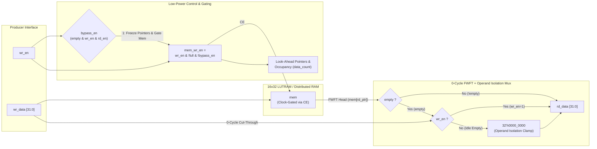

### 2. How the Datapath Eliminates Latency & Dynamic Power

The datapath is divided into four functional stages working together to achieve zero-cycle read latency while minimizing switching activity:

1. **Producer Interface (`wr_en`, `wr_data`):**
   * Feeds incoming 32-bit words into both the LUTRAM storage array and the cut-through bypass path simultaneously.
2. **Low-Power Control & Gating (`bypass_en`, `mem_wr_en`):**
   * **`bypass_en` Detector:** Triggers when the FIFO is empty and both `wr_en` and `rd_en` assert in the same clock cycle (`empty && wr_en && rd_en`).
   * **Clock-Enable Gate (`mem_wr_en`):** Enables the memory write clock-enable (`CE`) **only** when a word must be stored (`wr_en && !full && !bypass_en`). During a cut-through bypass, `mem_wr_en` remains `0`, keeping `mem[0:15]` and the read/write pointers frozen with zero flip-flop toggling.
3. **16×32 LUTRAM Storage (`mem[0:15]`):**
   * Synthesizes into Xilinx Artix-7 distributed memory with hardware clock-enable (`CE`) gating, storing up to 16 words when the consumer is not reading immediately.
4. **0-Cycle FWFT + Operand Isolation Output Mux (`rd_data`):**
   * **When `!empty` (Normal FWFT):** Selects `mem[rd_ptr]` combinationally without an output register, presenting the oldest word immediately (`0`-cycle read latency).
   * **When `empty && wr_en` (Cut-Through Bypass):** Routes `wr_data` straight to `rd_data` in the same clock cycle.
   * **When `empty && !wr_en` (Operand Isolation):** Clamps `rd_data` to `32'h0000_0000` during idle empty cycles to prevent stale bus transitions from toggling downstream combinational logic.

---

## Hardware PPA Benchmark Report (Artix-7 @ 200 MHz / `5.000 ns`)

All utilization, timing, and SAIF-driven dynamic power metrics were captured under identical Vivado synthesis and timing constraints (`xc7a35tifgg484-1L`, `create_clock -period 5.000`).

| Category | Benchmark Metric | Baseline (`basic_sync_fifo`) | Optimized (`lp_fwft_fifo`) | Delta / Engineering Analysis |
| :--- | :--- | :---: | :---: | :--- |
| **Architecture** | **Target FPGA & Clock** | Artix-7 (`200 MHz` / `5.000 ns`) | Artix-7 (`200 MHz` / `5.000 ns`) | Identical synthesis & timing environment |
| **Architecture** | **Read Latency** | `1 Clock Cycle` (Registered output) | **`0 Clock Cycles`** (FWFT + Bypass) | **-100% read latency**; immediate empty pass-through |
| **Architecture** | **Threshold Control** | Static (`DEPTH - 2` / `2`) | **Dynamic Runtime** (`1..15`) | Prevents pipeline skid overflow & burst starvation |
| **Architecture** | **Fault & Depth Telemetry** | None (Silent drops/reads) | **`overflow`, `underflow`, `data_count[4:0]`** | Full protocol error detection & live occupancy |
| **Area** | **Slice Registers (FFs)** | `557` (`1.34%`) | **`533` (`1.28%`)** | **`-24 FFs` (`-4.3%`)** via output register elimination |
| **Area** | **Slice LUTs** | `159` (`0.76%`) | **`205` (`0.99%`)** | `+46 LUTs` (`+0.23%` of device) for bypass & clamping muxes |
| **Area** | **F8 Muxes / Control Sets** | `32` / `19` | **`0` / `17`** | **`-100%` F8 muxes**, `-2` unique clock control sets |
| **Timing** | **Worst Negative Slack (`WNS`)** | `1.840 ns` (`Fmax = 316.46 MHz`) | **`1.032 ns` (`Fmax = 252.02 MHz`)** | Meets `200 MHz` (`5.000 ns`) with `>1.0 ns` setup margin |
| **Timing** | **Worst Hold Slack (`WHS`)** | `0.152 ns` | **`0.150 ns`** | `0` failing endpoints across Setup, Hold & Pulse Width |
| **Power (SAIF)** | **Core Fabric Power (`Clk+Sig+Log`)** | `10 mW` (`7 + 2 + 1 mW`) | **`12 mW` (`7 + 3 + 2 mW`)** | Clock power steady at `7 mW` under 100% UVM stress |
| **Power (SAIF)** | **Total / Dynamic Power** | `115 mW` / `55 mW` (`I/O: 44 mW`) | **`143 mW` / `83 mW` (`I/O: 71 mW`)** | `+27 mW` from 17 new top-level package I/O pins |
| **Sign-Off** | **Verification Methodology** | Directed testbench | **UVM 1.2 (`100.00%` Coverage)** | Self-checking scoreboard (`FAIL = 0`) + SVA assertions |

> **Power Breakdown Note:** In standalone top-level FPGA synthesis, 86% of dynamic power (`71 mW`) comes from unbuffered package I/O pin toggling across the 17 new threshold and telemetry ports. Inside the FPGA core fabric, clock power remains completely flat at `7 mW` while memory clock-gating and operand isolation prevent idle switching.

### Vivado Synthesis, Timing & SAIF Power Reports

| Report | Baseline (`basic_sync_fifo`) | Optimized (`lp_fwft_fifo`) |
| :--- | :---: | :---: |
| **Utilization (`Slice LUTs / FFs`)** | 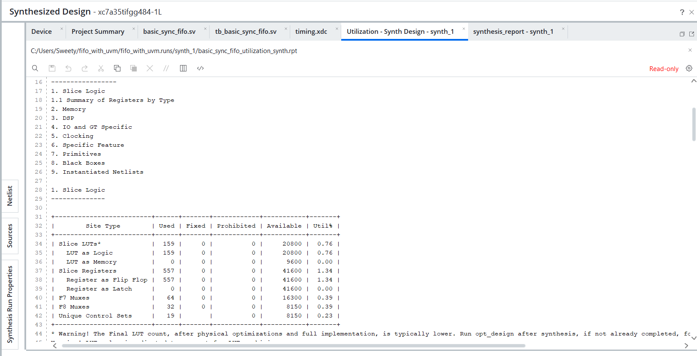 | 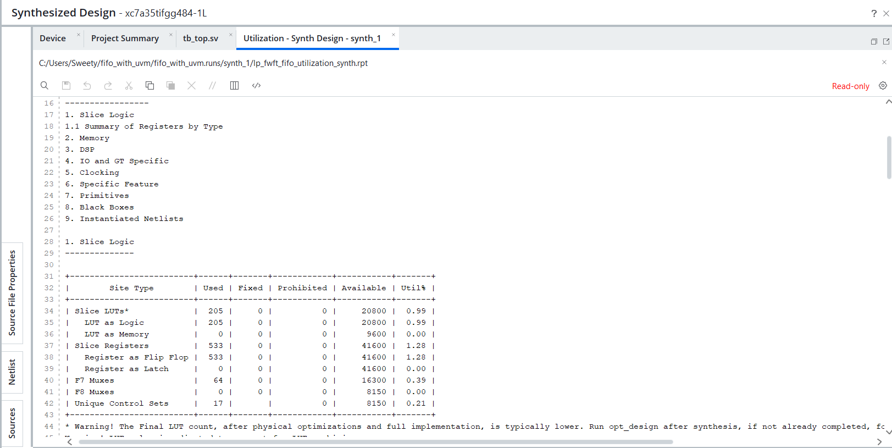 |
| **Timing Summary (`WNS / WHS`)** | 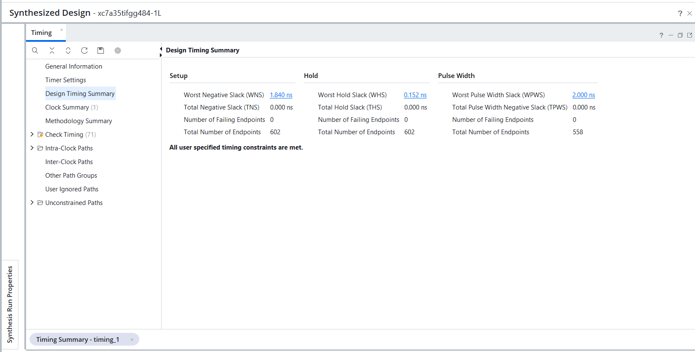 | 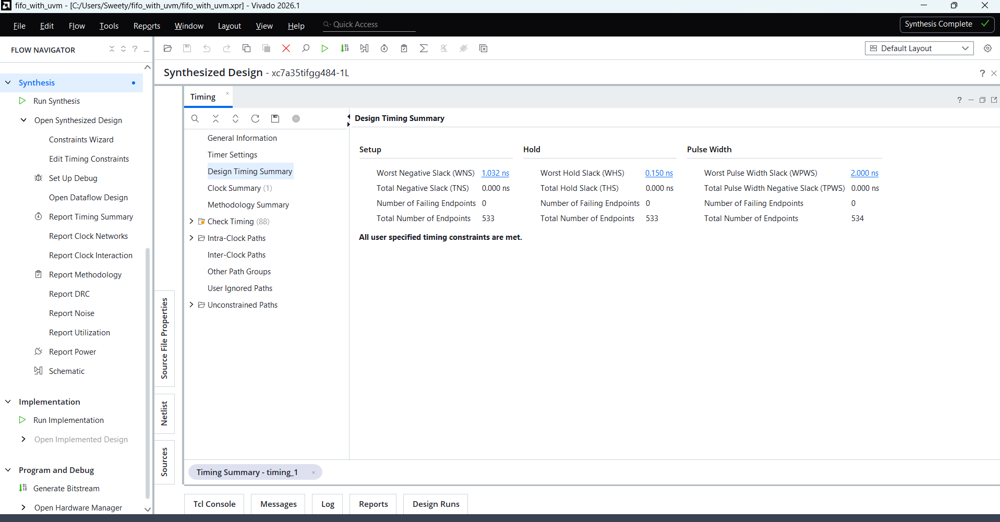 |
| **SAIF Power Analysis** | 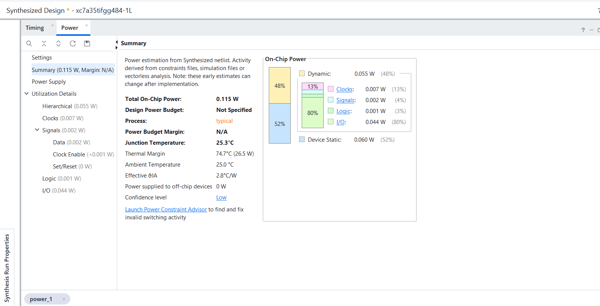 | 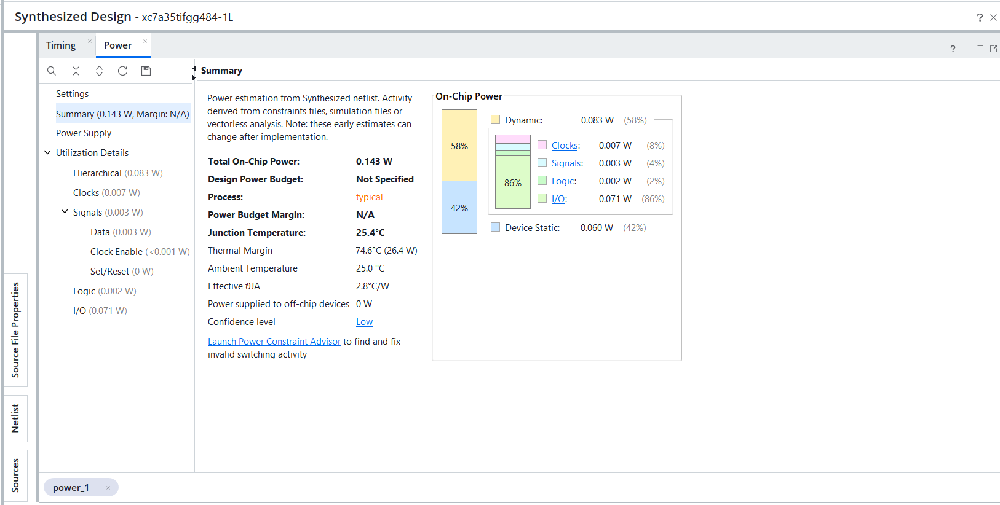 |
| **SAIF Switching Activity Log** | 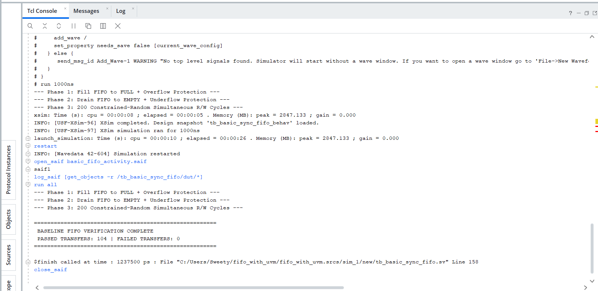 | 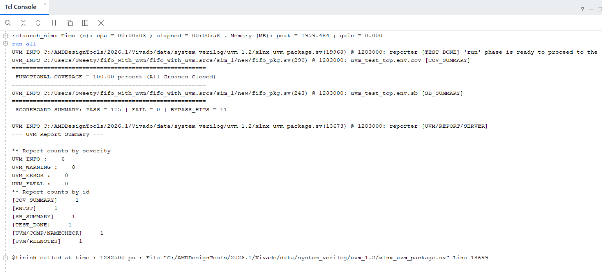 |

---

## UVM 1.2 Verification Environment

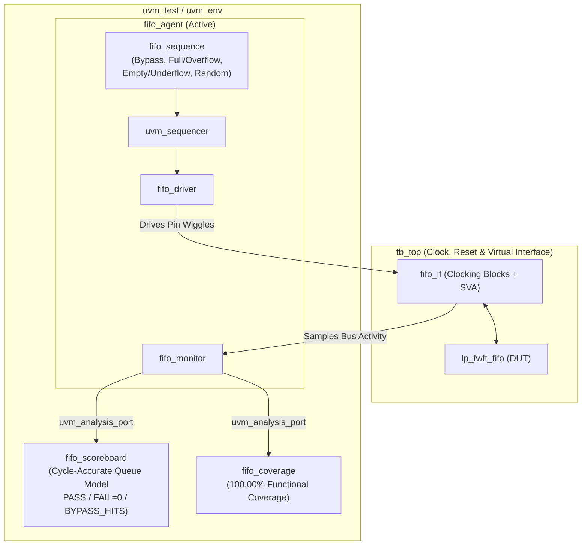

* **Constrained-Random Sequence (`fifo_seq_item`):** Drives empty cut-through bypass bursts, fill-to-full boundary sweeps, overflow injection, drain-to-empty sweeps, underflow injection, and dynamic threshold randomization (`prog_full_thresh` ∈ `[12:15]`, `prog_empty_thresh` ∈ `[1:4]`).
* **Self-Checking Reference Scoreboard:** Tracks cycle-accurate FIFO queue occupancy, simultaneous read/write updates, and bypass pass-through data with `FAIL = 0`.
* **Functional Coverage (`100.00%`):** Closes all coverpoints across operation modes (`WR_ONLY`, `RD_ONLY`, `SIMUL_WR_RD`, `IDLE`), boundary states (`EMPTY`, `FULL`, `ALMOST_FULL`, `ALMOST_EMPTY`), and corner cases (`OVERFLOW`, `UNDERFLOW`, `BYPASS`).

### UVM 1.2 Coverage & XSim Waveform Evidence

| Verification Scenario | Captured XSim / UVM Evidence |
| :--- | :---: |
| **UVM 100% Coverage & Scoreboard Summary (`08`)** |  |
| **Cut-Through Bypass & Write Enable (`09b`)** | 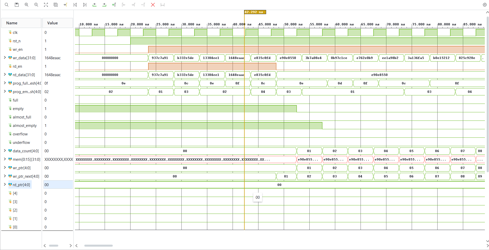 |
| **0-Cycle FWFT Read Enable (`10b`)** | 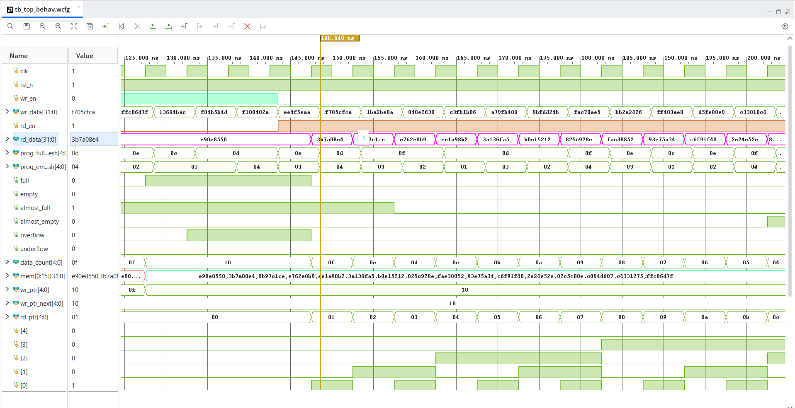 |
| **Full Boundary & Overflow Protection (`11b`)** | 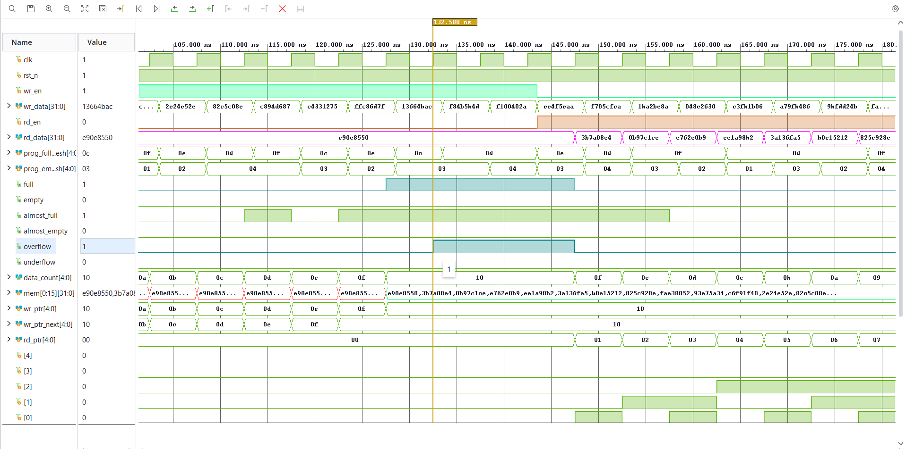 |
| **Empty Boundary & Underflow Protection (`12b`)** | 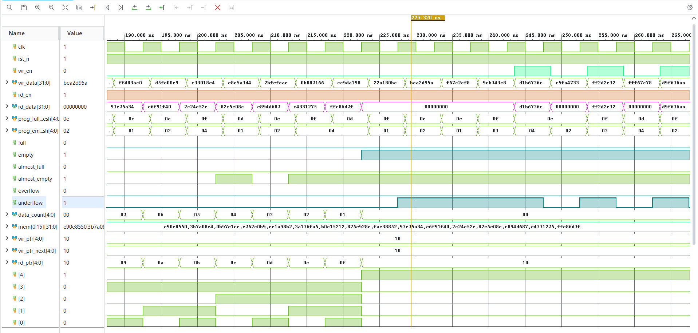 |

<details>
<summary><b>Click to expand Baseline Waveform Reference Captures (01–03)</b></summary>

| Baseline Scenario | Captured Evidence |
| :--- | :---: |
| **Baseline Full Condition (`01`)** | 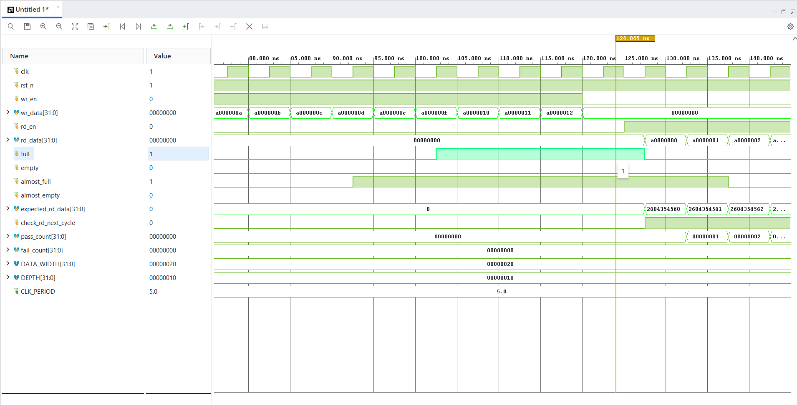 |
| **Baseline Empty Condition (`02`)** | 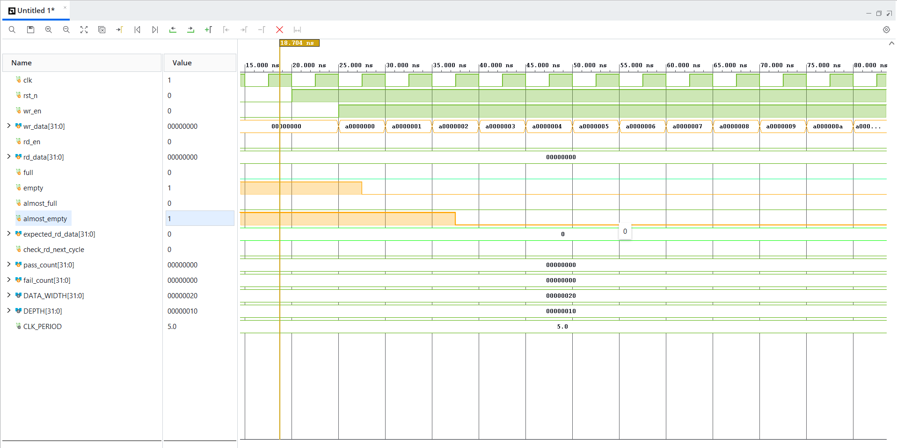 |
| **Baseline 1-Cycle Read Latency (`03`)** | 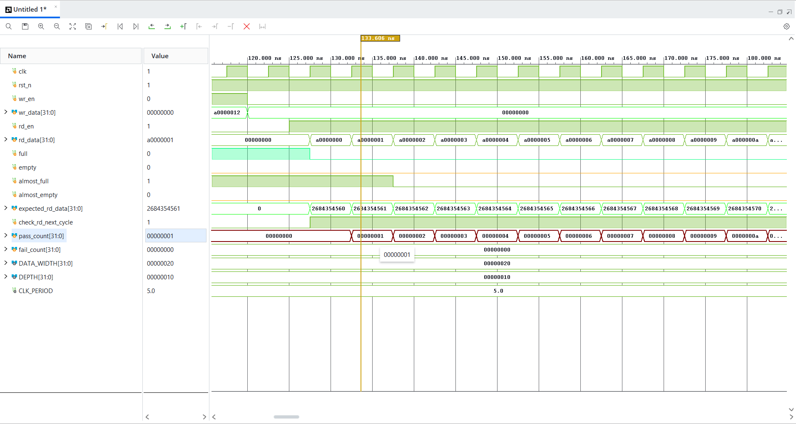 |

</details>

---

## Repository Structure

```text
lp-fwft-fifo-uvm/
├── rtl/
│   ├── basic_sync_fifo.sv            # Baseline 1-cycle latency synchronous FIFO
│   └── lp_fwft_fifo.sv               # Optimized 0-cycle FWFT + low-power FIFO
├── tb/
│   ├── fifo_if.sv                    # SystemVerilog interface with clocking blocks
│   ├── fifo_pkg.sv                   # UVM sequence item, sequence, driver, monitor, scoreboard, coverage
│   ├── tb_basic_sync_fifo.sv         # Directed testbench for baseline FIFO benchmarking
│   └── tb_top.sv                     # Top-level UVM testbench & clock/reset generator
├── images/                           # Vivado waveform, utilization, timing & SAIF power screenshots (01–16b)
├── constraints.tcl                   # 200 MHz (5.000 ns) Artix-7 clock constraint
├── tcl_commands                      # Vivado UVM compilation & SAIF power capture Tcl script
└── readme.md                         # Complete project documentation & PPA benchmark report
```

---

## Key Design & Verification Concepts (Project Q&A)

1. **Why doesn't `mem[0:15]` update during cut-through bypass (`empty && wr_en && rd_en`)?**
   When the FIFO is empty and the consumer is reading in the exact same cycle (`rd_en == 1`), storing `wr_data` into `mem[0]` only to read it out next cycle wastes 1 clock cycle of latency and toggles 32 memory flip-flops unnecessarily. `lp_fwft_fifo` routes `wr_data` directly to `rd_data` combinationally and gates `mem_wr_en = 0`.
2. **How do `prog_full_thresh` and `prog_empty_thresh` prevent pipeline stalls and overflows?**
   * **Skid Distance (`prog_full_thresh`):** If an upstream DMA master has 4 words already in flight when backpressure asserts, setting `prog_full_thresh = 12` (`DEPTH - 4`) triggers `almost_full` with 4 empty slots remaining—absorbing all in-flight words without triggering `overflow`.
   * **Burst Head-Start (`prog_empty_thresh`):** Setting `prog_empty_thresh = 6` keeps `almost_empty = 1` until 7 words are buffered, guaranteeing a downstream consumer (e.g., Ethernet MAC or Audio DAC) can run a continuous burst without stalling.
3. **Do `overflow` and `underflow` corrupt stored FIFO data?**
   No. The RTL blocks illegal writes when `full && !rd_en` (`mem_wr_en = 0`, `wr_ptr` frozen) and clamps `rd_data = 0` during illegal reads when `empty && !wr_en`, while asserting registered `overflow`/`underflow` pulses so system controllers can detect dropped packets or invalid reads.
4. **Why did `WNS` shift from `1.840 ns` (`316.46 MHz`) to `1.032 ns` (`252.02 MHz`)?**
   Removing the registered `rd_data` output flip-flop trades `0.808 ns` of excess timing slack (while still beating the `200 MHz` requirement by `>52 MHz`) in order to eliminate an entire clock cycle of read latency.

---

## How to Run in Vivado

1. Create a Vivado RTL project targeting **Artix-7 (`xc7a35tifgg484-1L`)**.
2. Add `rtl/basic_sync_fifo.sv` and `rtl/lp_fwft_fifo.sv` as **Design Sources**, `constraints.tcl` as **Constraints**, and `tb/fifo_if.sv`, `tb/fifo_pkg.sv`, `tb/tb_top.sv` as **Simulation Sources** (set File Type to **SystemVerilog**).
3. Run the UVM compilation and SAIF capture commands from `tcl_commands` in the Vivado Tcl Console:
   ```tcl
   set_property -name {xsim.compile.xvlog.more_options} -value {-L uvm} -objects [get_filesets sim_1]
   set_property -name {xsim.elaborate.xelab.more_options} -value {-L uvm} -objects [get_filesets sim_1]
   ```
4. Launch **Behavioral Simulation**, execute SAIF logging (`open_saif lp_fwft_activity.saif`, `log_saif [get_objects -r /tb_top/dut/*]`, `run all`, `close_saif`), and run **Synthesis** to inspect Utilization, Timing Summary, and SAIF-driven Power.